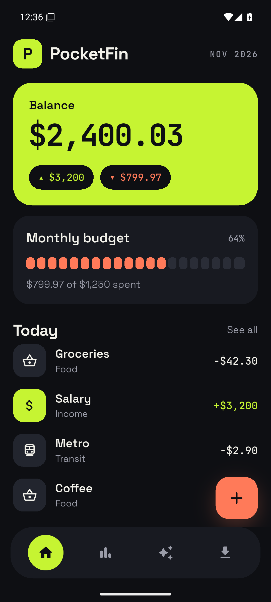
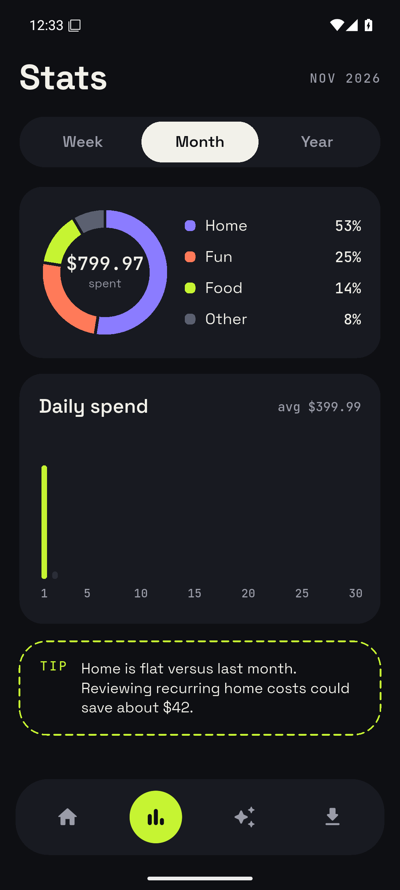
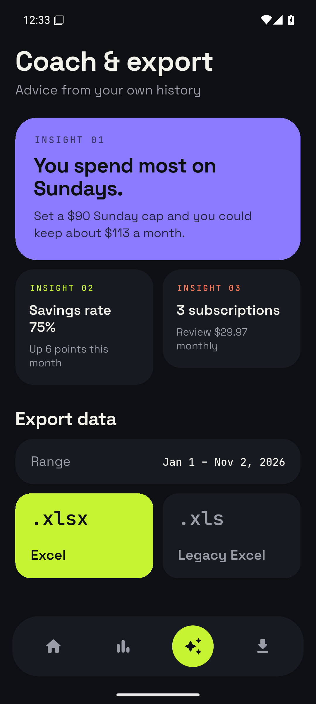
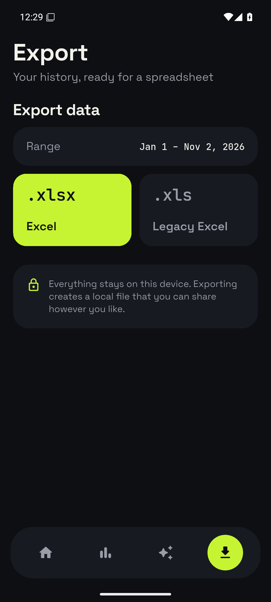
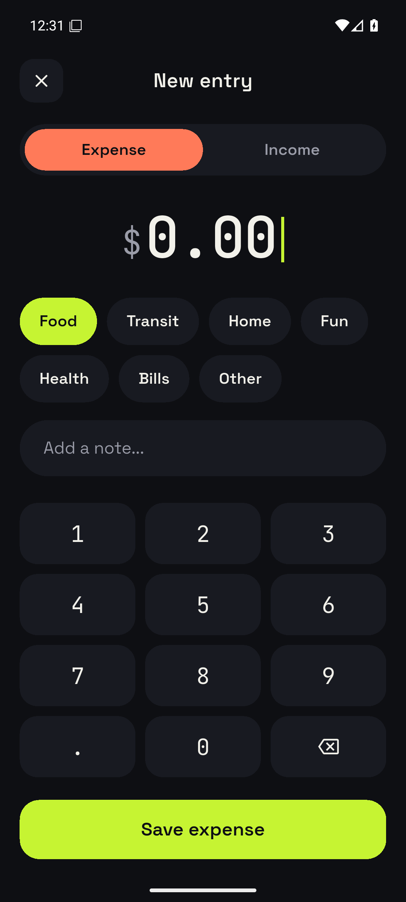

<div align="center">

# 💸 PocketFin

**Super powerful, lightweight mobile app to track financial expenses.**

[](https://flutter.dev/)
[](https://dart.dev/)
[](LICENSE)

---

</div>

## 📌 Overview

**PocketFin** is a minimalist yet feature-packed mobile application built with Flutter to help users take control of their personal finances. Designed with speed and privacy in mind, PocketFin makes logging daily transactions friction-free while delivering deep statistical insights and financial advice to help you build better money habits.

---

## 📱 Screens

<p align="center">
  
  
  
  
  
</p>

---

## ✨ Features

- ⚡ **Frictionless Expense Logging:** Register incoming and outgoing transactions (income & expenses) in seconds with a clean, intuitive interface.
- 📊 **Tons of Advices & Statistics:** 
  - Dynamic charts and visual breakdowns of spending habits.
  - Smart financial tips and personalized advice based on historical spending data.
- 📁 **Data Export (Excel):** Export your transaction history to `.xlsx` and send it anywhere with the native share sheet. Legacy `.xls` is planned.
- 🚀 **Lightweight & Fast:** Optimized for low memory footprint and high performance across both iOS and Android.

---

## 🛠️ Tech Stack

- **Framework:** [Flutter](https://flutter.dev/) (Dart)
- **State Management:** [Riverpod](https://riverpod.dev/)
- **Navigation:** [go_router](https://pub.dev/packages/go_router) with a stateful bottom-nav shell
- **Storage:** [Drift](https://drift.simonbinder.eu/) on SQLite — fully offline
- **Charts:** [fl_chart](https://pub.dev/packages/fl_chart)
- **Data Export:** `excel` (`.xlsx`) + `file_saver`

---

## 🚀 Getting Started

Follow these instructions to set up and run PocketFin on your local machine.

### Prerequisites

Ensure you have installed:
- [Flutter SDK](https://flutter.dev/docs/get-started/install) (v3.0.0 or higher recommended)
- [Dart SDK](https://dart.dev/get-dart)
- Android Studio / Xcode (for emulation/device testing)

### Installation

1. **Clone the repository:**
   ```bash
   git clone https://github.com/your-username/pocketfin.git
   cd pocketfin
   ```

2. **Install dependencies:**
   ```bash
   flutter pub get
   ```

3. **Run the application:**
   ```bash
   flutter run
   ```

### Demo data

The app starts empty. To preview the UI with a month of realistic data
(matching the mockups):

```bash
flutter run --dart-define=SEED_DEMO=true
```

Demo data is only inserted when the database is empty.

---

## 📂 Project Structure

```text
lib/
├── core/
│   ├── constants/       # Transaction types and categories
│   ├── router/          # go_router setup
│   ├── theme/           # Palette, typography, formatters
│   └── widgets/         # Shared cards, tabs, tiles, empty states
├── data/
│   ├── local/           # Drift database and generated schema
│   ├── repositories/    # Transaction persistence
│   ├── services/        # Excel export
│   └── demo_seed.dart   # Optional preview data
├── logic/
│   ├── analytics.dart   # Summaries, charts data, insights
│   └── providers.dart   # Riverpod graph
├── presentation/
│   ├── home/            # Balance, budget and today's entries
│   ├── stats/           # Donut, daily bars and tips
│   ├── coach/           # Insights from history
│   ├── export/          # XLSX export
│   ├── add_entry/       # Custom keypad entry flow
│   └── shell/           # Bottom navigation
├── app.dart
└── main.dart
```

---

## ✅ Development Commands

```bash
flutter analyze                 # Static analysis
flutter test                    # Unit and widget tests
dart run build_runner build     # Regenerate Drift code after schema changes
```

---

## 🤝 Contributing

Contributions are welcome! If you have suggestions or improvements:

1. Fork the Project
2. Create your Feature Branch (`git checkout -b feature/AmazingFeature`)
3. Commit your Changes (`git commit -m 'Add some AmazingFeature'`)
4. Push to the Branch (`git push origin feature/AmazingFeature`)
5. Open a Pull Request

---

## 📄 License

Distributed under the MIT License. See `LICENSE` for more information.
